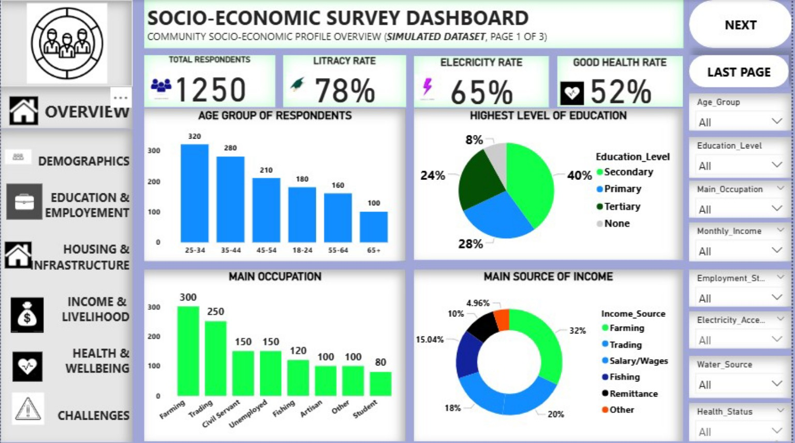
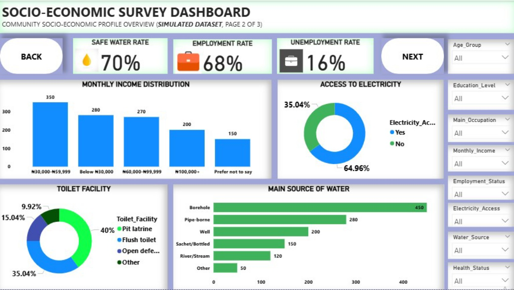
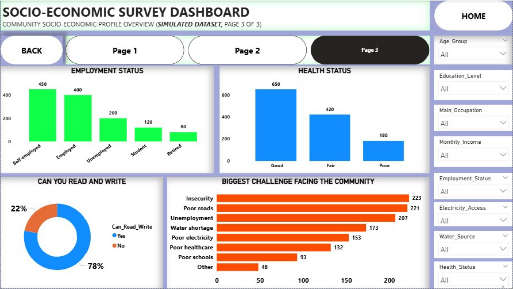

# Socio-Economic Survey Dashboard

**A three-page community socio-economic profile dashboard built with a simulated dataset.**

This portfolio project presents an overview of community demographics, education, employment, income, access to basic infrastructure, health status, and perceived community challenges.

> **Data disclaimer:** The data used in this project is simulated for learning and portfolio demonstration. It is not based on actual responses collected from a community.

## Table of Contents

- [Project Overview](#project-overview)
- [Dashboard Preview](#dashboard-preview)
  - [Page 1: Community Profile Overview](#page-1-community-profile-overview)
  - [Page 2: Income and Infrastructure](#page-2-income-and-infrastructure)
  - [Page 3: Employment, Health, and Community Challenges](#page-3-employment-health-and-community-challenges)
- [Dataset](#dataset)
- [Key Questions](#key-questions)
- [Tools and Skills](#tools-and-skills)
- [Repository Contents](#repository-contents)
- [How to Use](#how-to-use)
- [Limitations](#limitations)
- [Author](#author)

---

## Project Overview

The dashboard uses KPI cards, bar charts, doughnut charts, filters, and multi-page navigation to communicate key indicators in an accessible visual format.

### Project Objectives

- Summarise the demographic profile of respondents.
- Explore education, literacy, occupation, and income categories.
- Present access to electricity, water, and sanitation.
- Compare employment and health-status categories.
- Highlight the most frequently listed community challenges.

## Dashboard Preview

### Page 1: Community Profile Overview

**Key visuals:** respondent count, headline indicators, age-group distribution, education level, main occupation, and main source of income.

### Page 2: Income and Infrastructure

**Key visuals:** monthly income distribution, electricity access, toilet facilities, main water sources, and headline water and employment indicators.

### Page 3: Employment, Health, and Community Challenges

**Key visuals:** employment status, health status, literacy, and the biggest challenges facing the simulated community.

## Dataset

The repository includes `simulated-community-socioeconomic-data.csv`, a synthetic dataset containing **1,250 illustrative records**.

The columns cover respondent ID, age group, education level, literacy, occupation, employment status, monthly income, income source, electricity access, water source, safe-water access, toilet facility, health status, and community challenges.

**Please note:** The CSV is a synthetic demonstration dataset prepared to accompany the dashboard screenshots. It is not the original underlying survey dataset. Individual-level combinations are illustrative and should not be used to make claims about a real community. Some dashboard headline rates may use definitions or denominators that differ from the category counts.

## Key Questions

- Which age groups are most represented?
- What do the education and literacy categories show?
- Which occupations and income bands appear most frequently?
- What are the main sources of income and water?
- How is access to electricity distributed?
- How are employment and health-status categories distributed?
- Which community challenges have the highest counts?

## Tools and Skills

- **Data visualisation and storytelling**
- KPI cards and percentage indicators
- Bar charts and doughnut charts
- Filters and slicers
- Multi-page dashboard navigation
- Dataset preparation and documentation
- Communicating limitations of simulated data

**Software:** 
Microsoft Power BI

## Repository Contents

| File | Description |
|---|---|
| `README.md` | Project overview and documentation |
| `dashboard-page-1.jpg` | Community profile overview |
| `dashboard-page-2.jpg` | Income and infrastructure |
| `dashboard-page-3.jpg` | Employment, health, and community challenges |
| `simulated-community-socioeconomic-data.csv` | Synthetic practice dataset |

## How to Use

1. Open or download `simulated-community-socioeconomic-data.csv`.
2. Import the CSV into Excel or Power BI for practice.
3. Review the three dashboard screenshots to understand the report layout.
4. If the original `.pbix` report is added later, open it in Power BI Desktop to explore the report itself.

## Limitations

- The dataset is simulated, not collected from actual respondents.
- Individual-level records are illustrative.
- Confirm KPI definitions and denominators before interpreting dashboard percentages.
- The screenshots show the dashboard layout; they do not provide an interactive dashboard experience by themselves.

## Author

## Ogbodo Nehemiah Izuchukwu
Data Analysis | Data Visualisation | Statistics | Power BI | Excel
